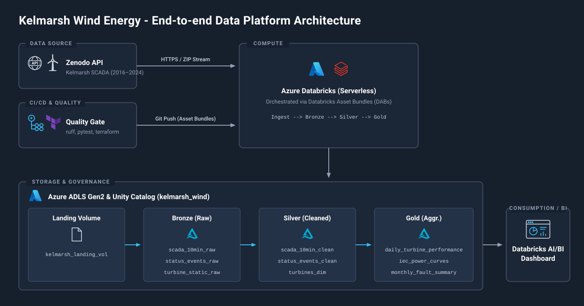
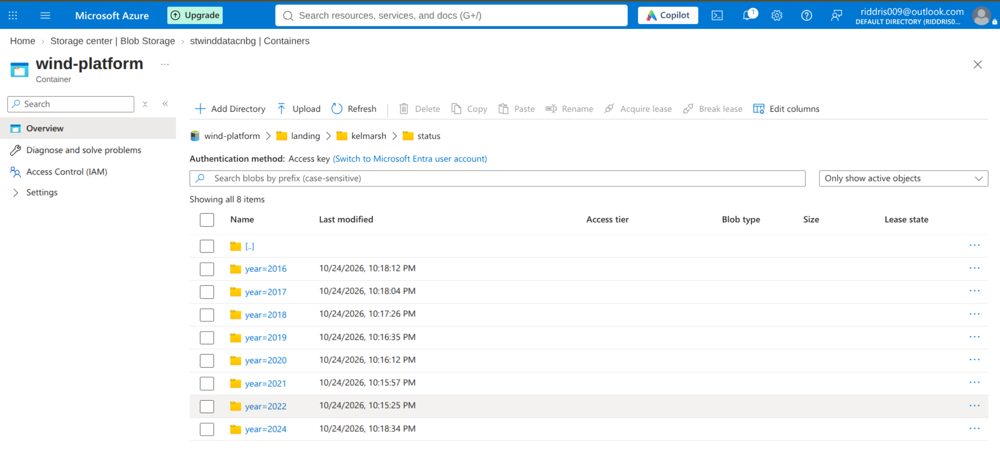
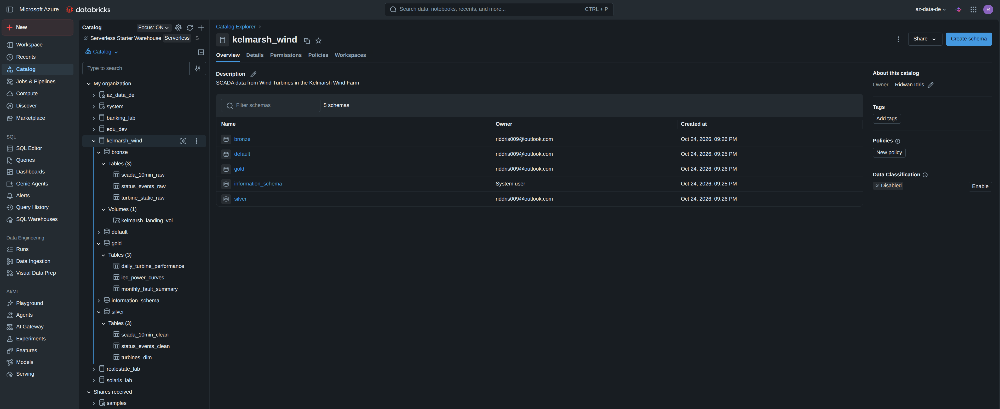
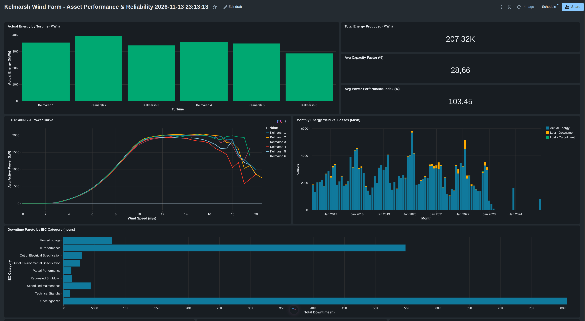
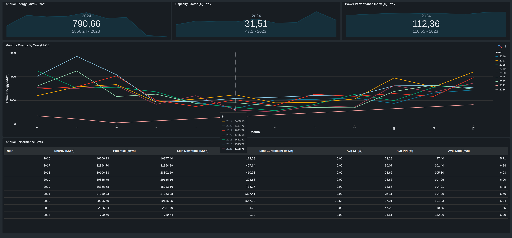
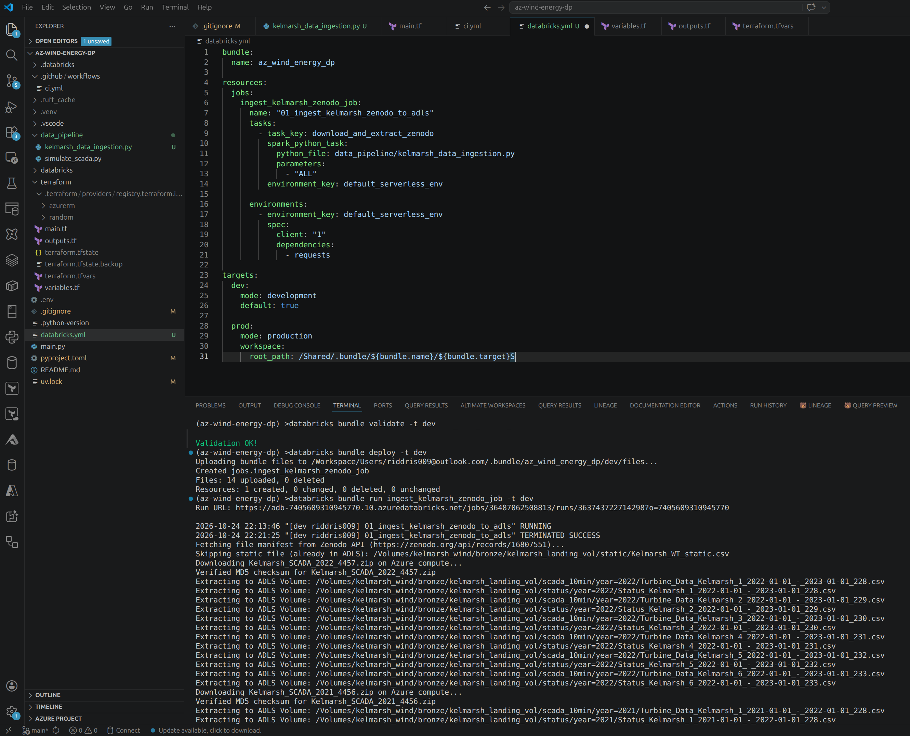

# European Wind Energy Data Platform on Azure Databricks

An end-to-end, production-grade Lakehouse and Machine Learning Digital Twin platform built on **Azure Databricks (Serverless)** and **Azure Data Lake Storage Gen2 (ADLS Gen2)**. This project ingests, cleans, models, scores, and visualizes 9 years (**2016–2024**) of high-frequency 10-minute operational SCADA telemetry and fault event logs (~3.8 GB compressed, **~2.84 million SCADA intervals**, and **~275,000 status events**) from the **Kelmarsh Wind Farm (UK)** using **Terraform**, **Unity Catalog**, **Databricks Asset Bundles (DABs)**, **PySpark / Auto Loader**, **MLflow & scikit-learn**, **Databricks Lakeview AI/BI Dashboards**, and **GitHub Actions CI/CD**.

---

## Table of Contents

1. [Architecture Overview](#1-architecture-overview)
2. [Tech Stack & Key Capabilities](#2-tech-stack--key-capabilities)
3. [Repository Structure](#3-repository-structure)
4. [Infrastructure as Code (Terraform & Unity Catalog)](#4-infrastructure-as-code-terraform--unity-catalog)
5. [Cloud-to-Cloud Ingestion Pipeline](#5-cloud-to-cloud-ingestion-pipeline)
6. [Medallion Architecture & Data Catalog](#6-medallion-architecture--data-catalog)
   - [Bronze Layer (Raw Ingestion via Auto Loader)](#61-bronze-layer-raw-ingestion-via-auto-loader)
   - [Silver Layer (Cleaned, Validated & Enriched)](#62-silver-layer-cleaned-validated--enriched)
   - [Gold Layer (Analytics, Domain KPIs & ML Anomalies)](#63-gold-layer-analytics-domain-kpis--ml-anomalies)
   - [Machine Learning Digital Twin & Anomaly Detection](#64-machine-learning-digital-twin--anomaly-detection)
7. [Databricks AI/BI Lakeview Dashboard](#7-databricks-aibi-lakeview-dashboard)
8. [Databricks Asset Bundles (DABs) Orchestration](#8-databricks-asset-bundles-dabs-orchestration)
9. [Testing & CI/CD Quality Gate](#9-testing--cicd-quality-gate)
10. [Serverless Engineering Lessons Learned](#10-serverless-engineering-lessons-learned)
11. [Deployment & Reproduction Guide](#11-deployment--reproduction-guide)

---

## 1. Architecture Overview



### Domain Context: Kelmarsh Wind Farm
The [Kelmarsh Wind Farm](https://doi.org/10.5281/zenodo.16807551) in Northamptonshire, UK consists of **6 Senvion MM92 wind turbines**, each with a **2,050 kW rated capacity** (12.3 MW total farm capacity), 92.5 m rotor diameter, and 68.5 m hub height. Each turbine reports over 110 operational telemetry channels at 10-minute intervals alongside IEC 61400-25 status/fault logs.

---

## 2. Tech Stack & Key Capabilities

| Layer | Technology | Purpose |
| :--- | :--- | :--- |
| **Cloud & Storage** | Azure Data Lake Storage Gen2 (ADLS Gen2) | Hierarchical namespace (`is_hns_enabled = true`) object storage backing Unity Catalog Volumes & Delta tables |
| **Infrastructure as Code** | Terraform (`azurerm`) | Automated provisioning of ADLS Gen2, Databricks Access Connector (System-Assigned Managed Identity), and RBAC roles |
| **Data Governance** | Databricks Unity Catalog | 3-level namespace (`kelmarsh_wind.<schema>.<table>`), Storage Credentials, External Locations, and External Volumes |
| **Compute & Orchestration** | Databricks Serverless Workflows & DABs | Declarative multi-task DAG deployment (`databricks.yml`) running on zero-management Serverless compute (`client: "1"`) |
| **Stream & Batch Processing** | PySpark & Databricks Auto Loader (`cloudFiles`) | Incremental file ingestion with schema evolution, Delta Column Mapping, Window deduplication, and Liquid Clustering |
| **Machine Learning & MLOps** | `scikit-learn` & MLflow (Unity Catalog Registry) | `HistGradientBoostingRegressor` Digital Twin power curve modeling, Unity Catalog model registration, and residual anomaly scoring |
| **BI & Visualization** | Databricks AI/BI Lakeview Dashboards | Interactive executive & asset reliability dashboard exported as code (`dashboards/kelmarsh_wind_dashboard.lvdash.json`) |
| **Environment & Packaging** | `uv` (Astral) & Python 3.12 | Deterministic dependency locking (`uv.lock`) aligned with Databricks Serverless Environment v5 constraints |
| **Quality & CI/CD** | GitHub Actions, `pytest`, `ruff`, `databricks-connect` | Automated linting, formatting, Spark Connect unit testing, and Terraform validation on every push/PR |

---

## 3. Repository Structure

```text
az-wind-energy-dp/
├── .github/
│   └── workflows/
│       └── ci.yml                                  # GitHub Actions CI pipeline (Ruff, Pytest, Terraform validate)
├── dashboards/
│   ├── kelmarsh_wind_dashboard.lvdash.json         # Databricks Lakeview AI/BI Dashboard definition
│   └── screenshots/                                # Architecture SVG & platform execution screenshots
├── data_pipeline/
│   ├── kelmarsh_data_ingestion.py                  # Cloud-to-cloud Zenodo API downloader & ZIP extractor
│   └── simulate_scada.py                           # Synthetic SCADA telemetry generator for local testing
├── databricks/
│   ├── bronze_ingestion.py                         # Auto Loader (cloudFiles) incremental Bronze ingestion
│   ├── silver_transformation.py                    # Data cleansing, standardization, DQ checks & deduplication
│   ├── gold_aggregations.py                        # Domain KPI aggregations (Daily Yield, IEC Curves, MTTR)
│   └── ml_power_prediction.py                      # ML Digital Twin training, UC registration & anomaly detection
├── terraform/
│   ├── main.tf                                     # ADLS Gen2, Access Connector & File Events RBAC definitions
│   ├── variables.tf                                # Input variables (subscription, resource group, workspace)
│   └── outputs.tf                                  # Provisioned resource outputs for Unity Catalog setup
├── tests/
│   └── test_pipeline.py                            # Unit tests for ingestion, preamble stripping & Spark expressions
├── databricks.yml                                  # Databricks Asset Bundle (DAB) job & pipeline definitions
├── pyproject.toml                                  # Project metadata, dependencies & Databricks constraint pins
├── uv.lock                                         # Deterministic dependency lockfile
└── README.md                                       # Project documentation
```

---

## 4. Infrastructure as Code (Terraform & Unity Catalog)

All underlying Azure cloud resources are provisioned declaratively in [`terraform/main.tf`](terraform/main.tf):

1. **ADLS Gen2 Storage Account (`azurerm_storage_account.adls`)**:
   - Provisioned with Hierarchical Namespace enabled (`is_hns_enabled = true`) and locally redundant standard storage (`Standard_LRS`).
   - Hosts the `wind-platform` container (`azurerm_storage_data_lake_gen2_filesystem.landing`).
2. **Unity Catalog Managed Identity (`azurerm_databricks_access_connector.unity_connector`)**:
   - Creates an Azure Databricks Access Connector with a `SystemAssigned` Managed Identity, eliminating long-lived client secrets or SAS tokens.
3. **Least-Privilege RBAC & Auto Loader File Events Roles**:
   - Assigns `Storage Blob Data Contributor` for Unity Catalog table and volume reads/writes.
   - Assigns `Storage Account Contributor`, `EventGrid EventSubscription Contributor`, and `Storage Queue Data Contributor` so Databricks Auto Loader can natively manage Azure Event Grid subscriptions and storage queues for incremental file discovery.

---

## 5. Cloud-to-Cloud Ingestion Pipeline

Rather than downloading 3.8 GB of archives to a local machine and re-uploading over residential bandwidth, [`data_pipeline/kelmarsh_data_ingestion.py`](data_pipeline/kelmarsh_data_ingestion.py) runs directly as a **Databricks Serverless Python job** (`01_ingest_kelmarsh_zenodo_to_adls`):

- **Manifest Discovery**: Queries the Zenodo REST API (`https://zenodo.org/api/records/16807551`) to dynamically retrieve file URLs, sizes, and MD5 checksums for all 2016–2024 archives and static metadata.
- **Ephemeral Streaming & Checksum Verification**: Streams each archive in 16 MB chunks to ephemeral node storage (`/tmp/zenodo_kelmarsh`) and validates its cryptographic MD5 digest against Zenodo metadata before extraction (`verify_md5`).
- **Partitioned Volume Extraction**: Streams CSV entries out of the ZIP archives directly into the Unity Catalog External Volume (`/Volumes/kelmarsh_wind/bronze/kelmarsh_landing_vol`), automatically routing files into year-partitioned directories:
  - `scada_10min/year=YYYY/Turbine_Data_Kelmarsh_<id>_<year>.csv`
  - `status/year=YYYY/Status_Kelmarsh_<id>_<year>.csv`
  - `static/Kelmarsh_WT_static.csv`
- **Idempotency**: Compares existing target file byte sizes in the Volume against ZIP header metadata (`member.file_size`) to skip already extracted files on re-runs.


*Year-partitioned raw Kelmarsh folders (`year=2016` through `year=2024`) landed inside the `wind-platform` ADLS Gen2 container.*

---

## 6. Medallion Architecture & Data Catalog

All tables are registered in Unity Catalog under the **`kelmarsh_wind`** catalog across three schemas: `bronze`, `silver`, and `gold`.


*Unity Catalog Explorer showing the `kelmarsh_wind` catalog, `kelmarsh_landing_vol` External Volume, and the Bronze, Silver, and Gold Delta tables.*

### Summary of Medallion Tables

| Layer | Full Table Name | Grain | Ingestion / Write Mode | Clustering / Partitioning | Approx. Rows |
| :--- | :--- | :--- | :--- | :--- | :--- |
| **Bronze** | `kelmarsh_wind.bronze.turbine_static_raw` | 1 row per turbine | Batch `overwrite` | Unclustered (6 rows) | 6 |
| **Bronze** | `kelmarsh_wind.bronze.scada_10min_raw` | 10-min turbine interval (raw) | Auto Loader (`availableNow`) | Append with `_metadata` | ~2,839,968 |
| **Bronze** | `kelmarsh_wind.bronze.status_events_raw` | 1 raw fault/status log event | Auto Loader (`availableNow`) | Append with `_metadata` | ~275,000+ |
| **Silver** | `kelmarsh_wind.silver.turbines_dim` | 1 row per turbine (`turbine_id`) | Batch `overwrite` | Unclustered Dimension | 6 |
| **Silver** | `kelmarsh_wind.silver.scada_10min_clean` | Unique `(turbine_id, event_timestamp)` | Batch `overwrite` | `CLUSTER BY (turbine_id, event_date)` | ~2,839,968 |
| **Silver** | `kelmarsh_wind.silver.status_events_clean` | Unique `(turbine_id, start_timestamp, status_code, status_message)` | Batch `overwrite` | `CLUSTER BY (turbine_id, event_date)` | ~271,000+ |
| **Gold** | `kelmarsh_wind.gold.daily_turbine_performance` | `(turbine_id, event_date)` | Batch `overwrite` | `CLUSTER BY (turbine_id, event_date)` | ~19,722 |
| **Gold** | `kelmarsh_wind.gold.iec_power_curves` | `(turbine_id, event_year, wind_speed_bin_ms)` | Batch `overwrite` | `CLUSTER BY (turbine_id, event_year)` | ~2,400+ |
| **Gold** | `kelmarsh_wind.gold.monthly_fault_summary` | `(turbine_id, event_year, event_month, status_type, iec_category)` | Batch `overwrite` | `CLUSTER BY (turbine_id, event_year)` | ~3,500+ |
| **Gold (ML)** | `kelmarsh_wind.gold.ml_turbine_anomalies` | `(turbine_id, event_date)` (2023–2024 scored) | Batch `overwrite` | `CLUSTER BY (turbine_id, event_date)` | ~4,380 |

---

### 6.1 Bronze Layer (Raw Ingestion via Auto Loader)
Implemented in [`databricks/bronze_ingestion.py`](databricks/bronze_ingestion.py):

- **Header Preamble Normalization (`strip_kelmarsh_preamble`)**: Raw Kelmarsh CSVs begin with 9 lines of `#` metadata comments followed by a `# Date and time` or `# Timestamp start` header row. An idempotent pre-processor strips the comment preamble once in-place and normalizes the header line before Spark reads the files.
- **Databricks Auto Loader (`cloudFiles`)**: Incrementally ingests `scada_10min` and `status` directories using `.trigger(availableNow=True)`, `cloudFiles.inferColumnTypes = true`, and `cloudFiles.schemaEvolutionMode = addNewColumns`.
- **Lineage Metadata Extraction**: Enriches every raw record with Unity Catalog `_metadata.file_path`, extracting `turbine_id` (via regex `Kelmarsh_(\d+)_`), `file_year` (via regex `year=(\d{4})`), and `ingested_at`.
- **Delta Column Mapping (`delta.columnMapping.mode = name`)**: Enabled on all Bronze tables to preserve raw physical engineering column names containing spaces, parentheses, units, and degree symbols (e.g., `Wind speed (m/s)`, `Blade angle (pitch position) A (°)`).

---

### 6.2 Silver Layer (Cleaned, Validated & Enriched)
Implemented in [`databricks/silver_transformation.py`](databricks/silver_transformation.py):

- **Safe Numeric Casting (`clean_numeric_col`)**: Raw SCADA CSVs represent sensor dropouts as literal `"NaN"`, `"-"`, or whitespace strings. `clean_numeric_col()` normalizes all non-numeric sentinel strings to SQL `NULL` before casting to `DOUBLE` or `INT`.
- **Window Deduplication**:
  - `silver.scada_10min_clean`: Deduplicates on `(turbine_id, event_timestamp)` ordered by `ingested_at DESC, source_file DESC`.
  - `silver.status_events_clean`: Deduplicates on `(turbine_id, start_timestamp, status_code, status_message)` and computes `duration_seconds` between `start_timestamp` and `end_timestamp` (using `F.try_to_timestamp` for open/malformed end timestamps).
- **Physics-Based Data Quality Flag (`is_valid_reading`)**: Flags each 10-minute SCADA interval based on physical Senvion MM92 operating boundaries:
  - `wind_speed_ms` between `0.0` and `50.0 m/s`
  - `active_power_kw` between `-150.0` (parasitic/grid draw) and `2500.0 kW` (transient peaks above 2,050 kW rated power)
  - `wind_direction_deg` between `0.0°` and `360.0°`
- **Delta Liquid Clustering**: Replaces traditional static Hive partitioning with `clusterBy("turbine_id", "event_date")` to optimize data skipping across both turbine-level and time-range queries without small-file overhead.

---

### 6.3 Gold Layer (Analytics, Domain KPIs & ML Anomalies)
Implemented in [`databricks/gold_aggregations.py`](databricks/gold_aggregations.py) and [`databricks/ml_power_prediction.py`](databricks/ml_power_prediction.py):

1. **`gold.daily_turbine_performance`**:
   - Joins valid 10-minute SCADA readings (`is_valid_reading = true`) with `silver.turbines_dim`.
   - Computes daily `actual_energy_kwh` (falling back to `active_power_kw / 6.0` when `energy_export_kwh` is null), `potential_energy_kwh`, `lost_downtime_kwh`, and `lost_curtailment_kwh`.
   - **Capacity Factor (%)**:
     $$\text{Capacity Factor (\%)} = \frac{\text{Actual Daily Energy (kWh)}}{\text{Rated Power (2050 kW)} \times 24\text{ h}} \times 100$$
   - **Power Performance Index (PPI %)**:
     $$\text{PPI (\%)} = \frac{\text{Actual Daily Energy (kWh)}}{\text{Potential Daily Energy (kWh)}} \times 100$$

2. **`gold.iec_power_curves`**:
   - Implements the **IEC 61400-12-1** wind turbine power performance standard by binning wind speeds into **0.5 m/s increments** (`ROUND(wind_speed_ms * 2.0, 0) / 2.0`).
   - Aggregates `interval_count`, `mean_wind_speed_ms`, `avg_active_power_kw`, `std_active_power_kw`, `avg_potential_power_kw`, `power_deficit_kw`, `avg_rotor_speed_rpm`, and `avg_pitch_angle_deg` per turbine and year.

3. **`gold.monthly_fault_summary`**:
   - Aggregates `silver.status_events_clean` by `turbine_id`, `event_year`, `event_month`, `status_type`, and `iec_category`.
   - Calculates monthly `event_count`, `total_duration_hours`, and **Mean Time To Resolve (`mttr_hours`)**.

4. **`gold.ml_turbine_anomalies`**:
   - Daily turbine anomaly summary generated by the Machine Learning Digital Twin (`databricks/ml_power_prediction.py`), joined with `silver.turbines_dim` and Liquid Clustered by `(turbine_id, event_date)`.

---

### 6.4 Machine Learning Digital Twin & Anomaly Detection
Implemented in [`databricks/ml_power_prediction.py`](databricks/ml_power_prediction.py):

- **Cyclical Feature Engineering (`add_cyclical_features`)**: Converts periodic wind direction (`0°–360°`) and calendar month (`1–12`) into continuous trigonometric features (`wind_dir_sin`, `wind_dir_cos`, `month_sin`, `month_cos`) alongside wind speed statistics (`wind_speed_ms`, `wind_speed_std_ms`, `wind_speed_max_ms`, `density_adj_wind_speed_ms`) and thermal readings (`ambient_temp_c`, `nacelle_temp_c`).
- **Healthy Baseline Training (`2016–2022`)**: Filters `silver.scada_10min_clean` to normal, un-curtailed operating intervals (`is_valid_reading == True`, `lost_prod_downtime_kwh <= 0`, and `lost_prod_curtailment_kwh <= 0`) across 2016–2022 to train a `scikit-learn` `HistGradientBoostingRegressor` predicting expected `active_power_kw`.
- **MLflow Tracking & Unity Catalog Model Registry**: Evaluates out-of-time 2023 predictions (`val_rmse_kw`, `val_mae_kw`, `val_r2_score`), infers the model signature, and registers the model directly in Unity Catalog as **`kelmarsh_wind.gold.turbine_power_digital_twin`**.
- **Unexplained Underperformance Anomaly Scoring (`2023–2024`)**: Scores all 2023–2024 intervals and flags stealth underperformance where the turbine is operating in the power-producing wind regime (`5.0–20.0 m/s`) with **zero logged downtime or curtailment**, yet exhibits a power deficit:
  $$\text{Power Residual (kW)} = \hat{P}_{\text{digital\_twin}} - P_{\text{actual}} > 250\text{ kW}$$
- Aggregates daily `evaluated_intervals`, `anomaly_intervals`, `anomaly_rate_pct`, `avg_power_residual_kw`, `max_power_residual_kw`, and `estimated_unexplained_loss_kwh` into `kelmarsh_wind.gold.ml_turbine_anomalies`.

---

## 7. Databricks AI/BI Lakeview Dashboard

The Gold layer powers an interactive **Databricks AI/BI Lakeview Dashboard** version-controlled at [`dashboards/kelmarsh_wind_dashboard.lvdash.json`](dashboards/kelmarsh_wind_dashboard.lvdash.json).

### Dashboard Datasets & Visual Components
- **Interactive Cross-Filtering**: Multi-select `Turbine` filter widget linked associatively across all three Gold datasets (`daily_performance`, `iec_power_curves`, and `fault_summary`).
- **Executive KPI Counters**:
  - *Total Energy Produced (MWh)*
  - *Average Capacity Factor (%)*
  - *Average Power Performance Index (%)*
- **Year-over-Year (YoY) Relative Comparison Cards**:
  - *Annual Energy (MWh) - YoY*
  - *Capacity Factor (%) - YoY*
  - *Power Performance Index (%) - YoY*
- **Engineering & Reliability Visualizations**:
  - **Actual Energy by Turbine (MWh)**: Categorical bar chart benchmarking lifetime output across Kelmarsh 1–6.
  - **IEC 61400-12-1 Power Curve**: Multi-series line chart plotting empirical `Avg Active Power (kW)` against `0.5 m/s` wind speed bins (`0–25 m/s`, filtered to bins with `interval_count >= 10`) per turbine.
  - **Monthly Energy Yield vs. Losses (MWh)**: Stacked temporal bar chart comparing *Actual Energy* against *Lost - Downtime* and *Lost - Curtailment*.
  - **Downtime Pareto by IEC Category (hours)**: Horizontal bar chart ranking total downtime hours across IEC fault/maintenance categories.
  - **Monthly Energy by Year (MWh) & Annual Performance Stats Table**: Seasonality trend lines and tabular breakdown of annual yield, potential energy, losses, CF%, PPI%, and wind resource.

### Dashboard Preview


*Executive overview: Actual Energy by Turbine (MWh), Total Energy / Capacity Factor / PPI counters, IEC 61400-12-1 Power Curves, Monthly Yield vs. Losses, and Downtime Pareto by IEC Category.*


*Year-over-Year (YoY) KPI comparison cards, Monthly Energy by Year seasonality curves, and the multi-year Annual Performance Stats summary table.*

### Importing the Dashboard in Databricks
1. In your Azure Databricks workspace, navigate to **Dashboards** -> **Create dashboard** -> **Import dashboard from file**.
2. Select [`dashboards/kelmarsh_wind_dashboard.lvdash.json`](dashboards/kelmarsh_wind_dashboard.lvdash.json).
3. Attach your Serverless SQL Warehouse and click **Publish**.

---

## 8. Databricks Asset Bundles (DABs) Orchestration

All jobs and serverless compute environments are defined as code in [`databricks.yml`](databricks.yml) across `dev` and `prod` targets:

| Job Resource Key | Job Name in Databricks | Task(s) | Purpose |
| :--- | :--- | :--- | :--- |
| `ingest_kelmarsh_zenodo_job` | `01_ingest_kelmarsh_zenodo_to_adls` | `download_and_extract_zenodo` | Streams raw archives from Zenodo to ADLS Volume |
| `bronze_ingestion_job` | `02_bronze_autoloader_ingestion` | `autoloader_to_bronze_delta` | Runs Auto Loader into Bronze Delta tables |
| `silver_transformation_job` | `03_silver_transformation` | `bronze_to_silver_delta` | Builds `turbines_dim`, `scada_10min_clean`, `status_events_clean` |
| `gold_aggregation_job` | `04_gold_kpi_aggregations` | `silver_to_gold_delta` | Builds Gold KPI tables for Lakeview BI |
| `medallion_end_to_end_pipeline` | `05_kelmarsh_medallion_orchestrator` | `bronze_autoloader` -> `silver_cleaning` -> `gold_kpis` -> `ml_digital_twin` | End-to-end multi-task Medallion + ML Digital Twin DAG |
| `ml_digital_twin_job` | `06_ml_power_digital_twin` | `train_and_score_digital_twin` | Trains HGB Digital Twin, registers in UC, writes `ml_turbine_anomalies` |


*Local IDE terminal validating (`databricks bundle validate`), deploying (`databricks bundle deploy`), and running the Serverless ingestion job with MD5 checksum verification and ADLS Volume extraction.*

---

## 9. Testing & CI/CD Quality Gate

### Unit Test Suite ([`tests/test_pipeline.py`](tests/test_pipeline.py))
The unit test suite validates core pipeline logic locally and in CI without requiring a live JVM Spark cluster:
- `test_extract_year_valid_and_unknown`: Verifies regex extraction of 2016–2024 years from Zenodo archive filenames and fallback to `"unknown"` for static files.
- `test_strip_kelmarsh_preamble_removes_comments`: Uses `pytest`'s `tmp_path` fixture to verify the 9-line `#` comment preamble is removed while `# Date and time,...` is normalized into a valid CSV header.
- `test_strip_kelmarsh_preamble_is_idempotent`: Verifies running `strip_kelmarsh_preamble` multiple times on already-cleaned files leaves them untouched.
- `test_clean_numeric_col_returns_spark_column`: Uses `databricks-connect`'s Spark Connect client-only `Column` API to verify `clean_numeric_col` constructs the expected `CASE WHEN ... CAST` expression handling `"NaN"` and `"-"`.
- `test_add_cyclical_features_computes_periodic_bounds`: Verifies `add_cyclical_features` maps periodic wind direction (`0°` and `360°`) and calendar month (`1–12`) to continuous sine/cosine coordinates.

### GitHub Actions Workflow ([`.github/workflows/ci.yml`](.github/workflows/ci.yml))
Triggered automatically on every `push` and `pull_request` to `main`:
1. **`python-quality` Job**:
   - Installs `uv` with caching enabled and provisions Python 3.12 (`uv python install`).
   - Installs locked dependencies (`uv sync --all-extras --dev`).
   - Enforces zero lint errors (`uv run ruff check .`) and strict code formatting (`uv run ruff format --check .`).
2. **`terraform-quality` Job**:
   - Runs `terraform fmt -check`, `terraform init -backend=false`, and `terraform validate` to guarantee infrastructure changes are syntactically valid before deployment.

---

## 10. Serverless Engineering Lessons Learned

Building and running this platform on **Databricks Serverless Compute** and **Unity Catalog** surfaced several real-world engineering challenges and architectural patterns:

### 1. Streaming `toTable()` Ignores `delta.*` Writer Options (Delta Column Mapping)
- **Problem**: Kelmarsh CSV headers contain spaces, commas, parentheses, and degree symbols (`Wind speed, Standard deviation (m/s)`, `Wind direction (°)`). Delta Lake rejects these characters unless `delta.columnMapping.mode = "name"` is enabled. However, when Auto Loader creates a new table via `df_stream.writeStream.format("delta").option("delta.columnMapping.mode", "name").toTable(...)`, Spark Structured Streaming silently ignores `delta.*` table property options during initial table creation, causing the stream to fail immediately with an invalid column name exception.
- **Solution**: In [`databricks/bronze_ingestion.py`](databricks/bronze_ingestion.py), before starting the streaming query, we check `if not spark.catalog.tableExists(full_table_name):` and pre-create an empty Delta table using a batch write (`spark.createDataFrame([], df_stream.schema).write.format("delta").option("delta.columnMapping.mode", "name").saveAsTable(full_table_name)`), which properly persists the table properties in Unity Catalog before Auto Loader appends to it.

### 2. Multi-Line `#` Comment Preambles in Scientific CSVs vs. Auto Loader
- **Problem**: Standard Spark CSV options (`comment = "#"`) strip *all* lines starting with `#`, including the Kelmarsh header line itself (`# Date and time,Wind speed (m/s),...`), causing Auto Loader to treat the first data row as the header or fail schema inference.
- **Solution**: Implemented `strip_kelmarsh_preamble()` as an idempotent pre-flight step that inspects only the first line of each CSV (`first_line.startswith("#")`). If present, it drops the metadata comments while stripping only the leading `# ` prefix from `# Date and time` / `# Timestamp start`, making subsequent runs a fast no-op.

### 3. Unity Catalog `_metadata` vs. Legacy `input_file_name()` on Serverless
- **Problem**: In Databricks Serverless / Unity Catalog Shared access mode, legacy Spark functions like `F.input_file_name()` are deprecated or restricted.
- **Solution**: Replaced legacy file introspection with Unity Catalog's hidden `_metadata.file_path` struct column (`F.col("_metadata.file_path")`), using regex extraction on the Volume path to derive `turbine_id` and `file_year` deterministically.

### 4. Local Unit Testing: `databricks-connect` vs. Standard `pyspark` Package Collisions
- **Problem**: Installing both `pyspark>=4.3.0` and `databricks-connect~=18.0.0` in the same virtual environment causes standard `pyspark` to overwrite `databricks-connect`'s Spark Connect modules. Classic `pyspark.sql.functions.col()` asserts that a live JVM `SparkContext._active_spark_context` exists, breaking lightweight unit tests, while enabling Spark Connect mode on mismatched packages triggers Protobuf gencode/runtime version errors (`gencode 6.33.5` vs `runtime 5.29.6` pinned by Databricks Environment v5).
- **Solution**: Rely exclusively on `databricks-connect~=18.0.0` in `dev` dependencies (which ships its own `pyspark` namespace). This allows `F.col()`, `F.when()`, and `Column` expressions in `silver_transformation.py` to build pure client-side logical plans during `pytest` runs with zero JVM overhead.

### 5. Liquid Clustering Over Hive Partitioning for Time-Series Telemetry
- **Problem**: Partitioning 10-minute SCADA data by `(turbine_id, event_date)` across 9 years would create $6 \times 3,287 \approx 19,722$ partition directories, leading to severe small-file overhead on ADLS Gen2.
- **Solution**: Used Delta **Liquid Clustering** (`.clusterBy("turbine_id", "event_date")` on Silver/Gold daily tables and `.clusterBy("turbine_id", "event_year")` on power curves and fault summaries) to achieve multi-dimensional Z-order-like data skipping without physical directory fragmentation.

### 6. MLflow Tracking in Serverless `spark_python_task` Jobs Requires Explicit `mlflow.set_experiment()`
- **Problem**: When running [`databricks/ml_power_prediction.py`](databricks/ml_power_prediction.py) as a plain Python script (`spark_python_task`) on Databricks Serverless rather than a Databricks Notebook, `mlflow.start_run()` failed with:
  ```text
  RestException: RESOURCE_DOES_NOT_EXIST: Could not find experiment with ID None
  ```
  Unlike interactive or job Notebooks—which automatically provision and attach a default notebook-scoped MLflow experiment—a standalone Python script on Serverless has no default experiment ID bound to its execution context unless `MLFLOW_EXPERIMENT_NAME` / `MLFLOW_EXPERIMENT_ID` is configured or `mlflow.set_experiment(...)` is called explicitly. Setting `mlflow.set_registry_uri("databricks-uc")` configures the Model Registry destination, but does not set the Tracking Experiment.
- **Solution**: Explicitly call `mlflow.set_experiment("/Users/<workspace-user>/kelmarsh_power_digital_twin")` before `with mlflow.start_run(...):`. `set_experiment()` automatically creates the workspace experiment on first execution if it does not yet exist and binds a valid experiment ID to the run.

---

## 11. Deployment & Reproduction Guide

### Prerequisites
- Azure Subscription with an **Azure Databricks Workspace** (Premium tier / Unity Catalog enabled)
- [Terraform CLI](https://developer.hashicorp.com/terraform/install) (`>= 1.5`) & [Azure CLI](https://learn.microsoft.com/en-us/cli/azure/install-azure-cli)
- [Databricks CLI](https://docs.databricks.com/en/dev-tools/cli/install.html) (`>= 0.220`)
- [uv](https://docs.astral.sh/uv/) Python package manager

### Step 1: Provision Azure Infrastructure with Terraform
```bash
cd terraform
terraform init
terraform plan -out=tfplan
terraform apply tfplan
```
Configure your Unity Catalog **Storage Credential**, **External Location**, catalog (`kelmarsh_wind`), schemas (`bronze`, `silver`, `gold`), and External Volume (`kelmarsh_wind.bronze.kelmarsh_landing_vol`) using the Terraform outputs (`storage_account_name`, `container_name`, `access_connector_id`).

### Step 2: Set Up Local Development Environment & Run Tests
```bash
# Install Python 3.12 and locked dependencies
uv sync --dev

# Run linter, formatter check, and unit tests
uv run ruff check .
uv run ruff format --check .
uv run pytest -v
```

### Step 3: Validate & Deploy Databricks Asset Bundle
```bash
# Validate bundle configuration
databricks bundle validate

# Deploy jobs to the development target
databricks bundle deploy -t dev

# 1. Run cloud-to-cloud Zenodo data ingestion into ADLS Volume (one-time or per year)
databricks bundle run ingest_kelmarsh_zenodo_job -t dev

# 2. Run the end-to-end Medallion + ML Digital Twin orchestrator (Bronze -> Silver -> Gold -> ML)
databricks bundle run medallion_end_to_end_pipeline -t dev

# Or run the standalone ML Digital Twin training & anomaly scoring job
databricks bundle run ml_digital_twin_job -t dev
```
